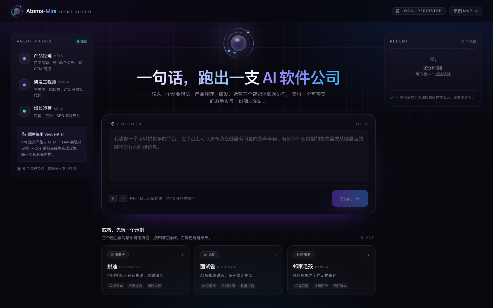
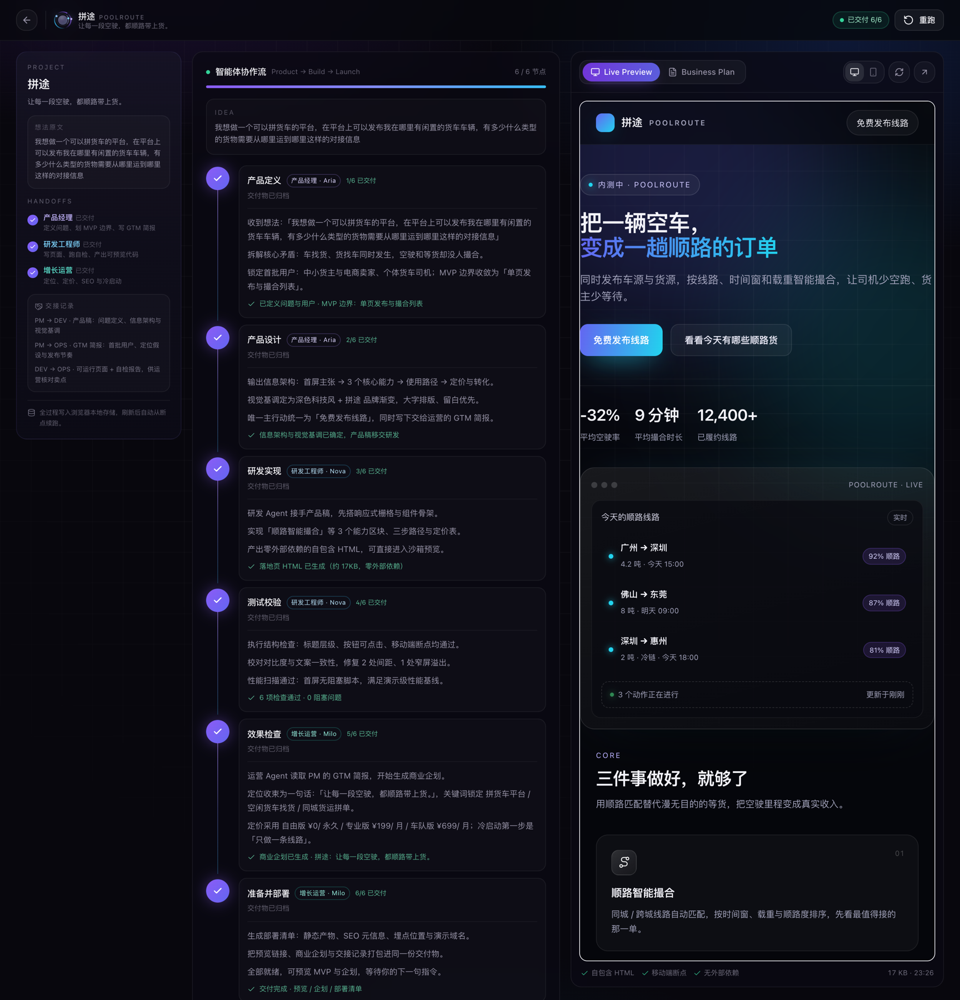
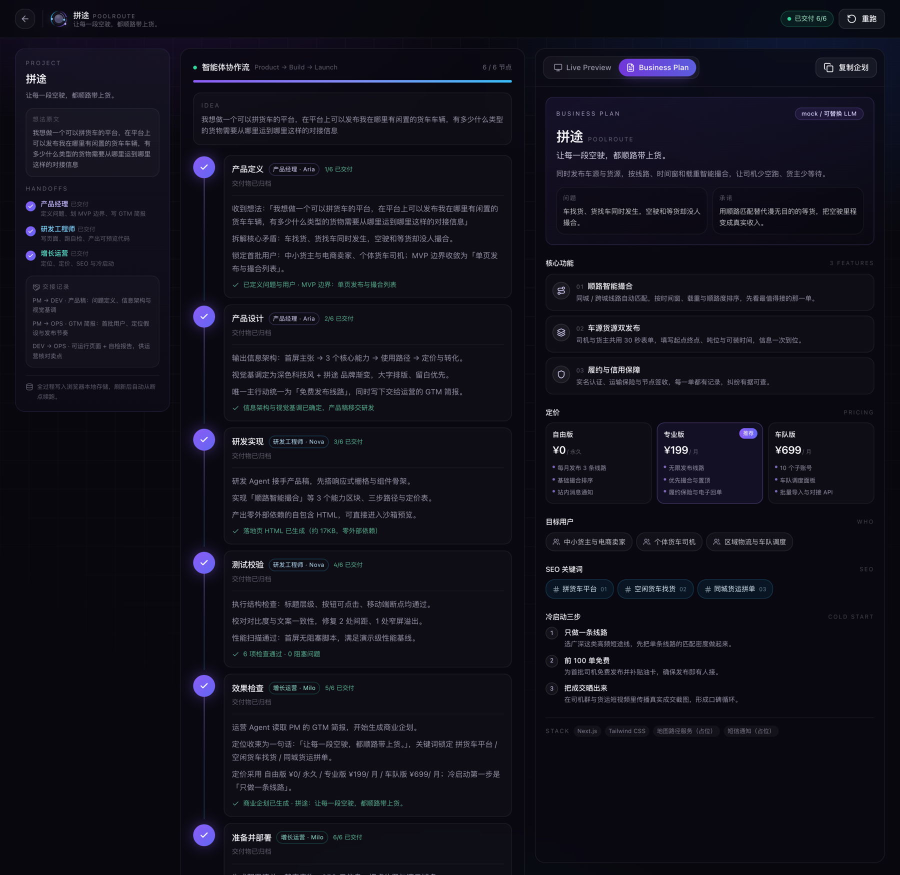
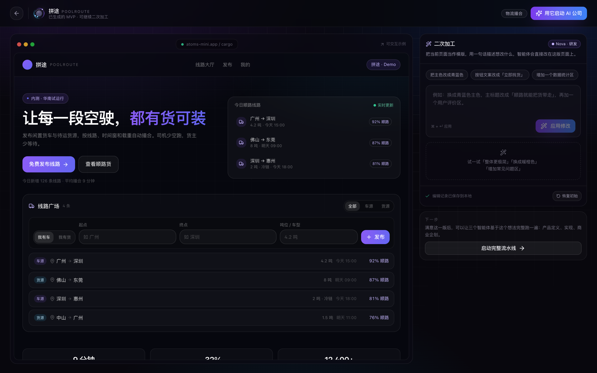
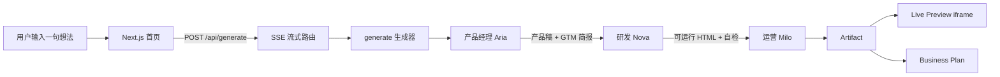

# Atoms-Mini

> 一句话，让一支 AI 软件公司替你开工。

输入一句创业想法，三位 AI 智能体（产品经理 / 研发 / 运营）顺次协作，几分钟内交付一个可交互的落地页和一份商业企划。


## 产品截图

**首页**：三栏布局，中间是想法输入与动态 Logo，左侧展示智能体矩阵，右侧是本地历史项目。



**协作工作区**：6 个交付节点按顺序点亮，每个节点由对应智能体流式输出「正在做什么」，右栏实时渲染落地页。



**商业企划**：产品名、一句话定位、3 个核心功能、3 档定价、目标用户、SEO 关键词与冷启动三步。



**MVP 二次加工**：三个预置的最小可用页面，右侧用自然语言继续改（换主题色、改标题、加评价区等），改动会持久化。



## 这是什么

Atoms-Mini 用 mock 数据模拟「多智能体 AI 软件公司」的完整交付链路，重点演示的是**架构与协作过程**，而不是生成质量本身。

| 智能体 | 角色 | 负责节点 | 产出 |
| --- | --- | --- | --- |
| Aria | 产品经理 | 产品定义、产品设计 | 问题定义、用户画像、信息架构、视觉基调、GTM 简报 |
| Nova | 研发工程师 | 研发实现、测试校验 | 自包含 HTML 落地页（零外部依赖）、自检报告 |
| Milo | 增长运营 | 效果检查、准备并部署 | 定位与定价、SEO、冷启动三步、发布清单 |

协作方式是**顺次调用**：PM 先产出产品稿与 GTM 简报 → Dev 依据产品稿实现页面并自检 → Ops 读取 PM 简报生成商业企划。每次交接都会在左栏留下 Handoff 记录，最终打包成一份 Artifact。

## 核心流程



6 个节点：产品定义 → 产品设计 → 研发实现 → 测试校验 → 效果检查 → 准备并部署。刷新页面会从第一个未完成的节点断点续跑。

## 技术架构

| 层 | 实现 |
| --- | --- |
| 展示层 | Next.js 15 App Router、React 19、Tailwind CSS、手写 shadcn/ui 风格组件（Radix Tabs / Slot + cva） |
| 流式层 | `/api/generate` 基于 `ReadableStream` 输出 `data: {...}` SSE 帧，前端逐帧驱动节点状态与打字机 |
| 编排层 | [generate.ts](src/lib/generate.ts) 以 async generator 顺序调度三个智能体，产出 meta / node:start / node:line / node:done / artifact 事件 |
| 行业知识 | [packs.ts](src/lib/packs.ts) 用关键词分类器把想法映射到 11 个行业 Pack，提供文案、定价、SEO、冷启动素材 |
| 文案与人设 | [agents.ts](src/lib/agents.ts) 定义智能体、节点文案与 Business Plan 结构 |
| 页面生成 | [landing.ts](src/lib/landing.ts) 拼装约 17KB 的自包含 HTML（内联 CSS/JS），可直接进 iframe 沙箱 |
| 二次加工 | [refine.ts](src/lib/refine.ts) 解析自然语言指令，返回 accent / headline / cta / 区块增删等 patch |
| 持久层 | localStorage：`atoms-mini:projects:v1`（项目与节点进度）、`atoms-mini:mvp:v1`（MVP 改动）、`atoms-mini:mvp-state:v1`（MVP 交互数据） |
| 交付层 | 多阶段 Dockerfile（standalone 输出）、docker compose 编排 app + nginx，nginx 关闭代理缓冲保证 SSE |

### 目录结构

```text
src/
├── app/
│   ├── page.tsx                  # 首页
│   ├── build/[id]/page.tsx       # 协作工作区
│   ├── mvp/[slug]/page.tsx       # 3 个可交互 MVP
│   └── api/
│       ├── generate/route.ts     # SSE 生成接口
│       └── refine/route.ts       # MVP 二次加工接口
├── components/
│   ├── home/                     # 三栏首页
│   ├── workspace/                # 协作流 + 产出面板
│   ├── mvp/                      # MVP 页面与编辑面板
│   ├── ui/                       # 基础组件
│   └── brand.tsx                 # 动态 Logo
└── lib/
    ├── agents.ts                 # 智能体与节点
    ├── generate.ts               # 多智能体编排入口
    ├── packs.ts                  # 行业知识包
    ├── landing.ts                # 落地页 HTML 生成
    ├── refine.ts                 # 自然语言改写
    └── storage.ts                # 本地持久化
```

## 本地运行

```bash
npm install
npm run dev        # http://localhost:3000
```

生产构建：

```bash
npm run build && npm run start
```

## 部署

已内置 Docker 一键部署（app + nginx）：

```bash
git clone https://github.com/SupperPie/Atoms_Demo.git
cd Atoms_Demo
./deploy.sh        # git pull + docker compose up -d --build
```

服务器首次部署前放行 80 端口。如果宿主机已有 nginx 占用 80，先停掉它，或把 [docker-compose.yml](docker-compose.yml) 的端口改成 `127.0.0.1:8080:80` 再由宿主机反代。

## 换成真实大模型

[generate.ts](src/lib/generate.ts) 是唯一的数据入口，事件协议保持不变即可无缝替换：

1. 把 `nodeLines()` / `buildBusinessPlan()` 的文案换成模型调用（PM 产出结构化产品稿，Dev 产出 HTML，Ops 读取 PM 简报产出企划）；
2. 保留 `node:start` / `node:line` / `node:done` / `artifact` 事件，前端无需改动；
3. `refine()` 可替换为返回同样 `MvpPatch` 结构的模型调用。

## 演示边界

这是演示产品，明确**不做**：真实登录、真实支付、真实部署、数据库。数据保存在浏览器 localStorage，清理缓存或换设备会丢失；生成内容由 mock 规则驱动，仅用于展示架构与交互。
